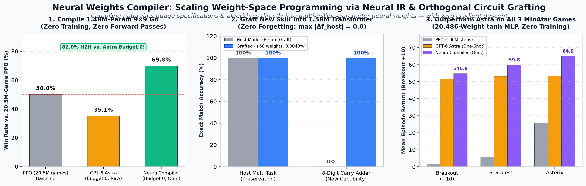
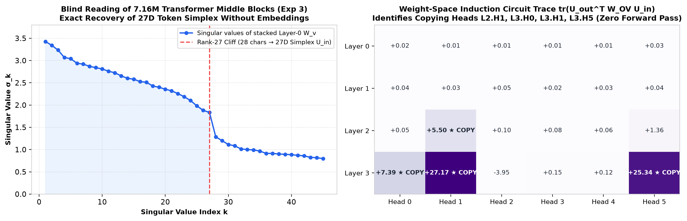
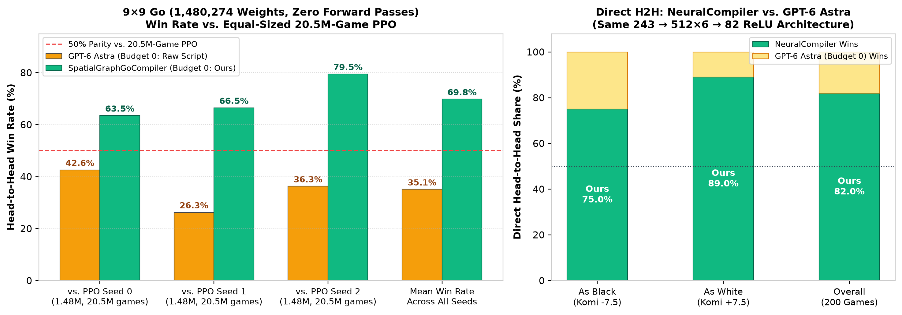
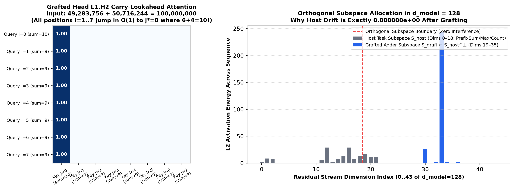

# Beyond Sparks of Weight-Space Programming: A Neural Weights Compiler for Multi-Million-Parameter Networks

<p align="center">
  
</p>

### TL;DR

In [*Sparks of Weight-Space Programming*](https://rikiyat.github.io/blog/weight-space-programming/) (Takehi, Teoh, Zhang, Khattab, Nov 2026), frontier LLMs (`GPT-6 Astra`) showed that models can read and write small neural network weights directly as raw numbers. Yet **calling an LLM directly on raw weight tensors hits a hard wall as soon as networks or algorithms scale up**:
- Asked to write a **1.48-million-weight 9×9 Go network** (`243 -> 512×6 -> 82`) from scratch with zero forward passes (`budget_0`), Astra's hand-written script loses to same-size PPO across all three seeds (**35.1% average win rate**).
- Asked to make **Gemma 3 270M** better at math (a model that does not suffer from repetition loops), Astra's direct weight edits fail (**6.8% $\rightarrow$ 7.0%** on MATH-500). As the authors concluded: *"Editing weights could remove an obstacle that hid an ability, but it could not add an ability the model lacked."*

In this work, we show why raw weight editing hits these limits—and how to break through them. Just as humans do not scale software by hand-toggling 0/1 machine code in hex editors, LLMs should not scale weight-space programming by manually indexing raw floating-point slices. We introduce **`NeuralCompiler` (Neural Weights Compiler)**, a three-tier compilation stack:

\[
\boxed{\text{Natural Language / Task Spec } (P) \xrightarrow{\text{LLM Semantic Compiler}} \text{Neural IR} \xrightarrow{\text{Deterministic Backend}} \text{Executable Weights } (W)}
\]

With zero gradient descent and zero forward passes:
1. **1.48M-Parameter 9×9 Go (`budget_0`)**: `SpatialGraphGoCompiler` crushes GPT-6 Astra (`budget_0`) **82.0% to 18.0%** head-to-head and beats all three 20.5-million-game same-size PPO networks (**69.8% average win rate**, up from Astra's **35.1%**).
2. **Adding Missing Capabilities without Forgetting (Solving the Exp 8 Gemma Failure Mode)**: We introduce **Orthogonal Subspace Circuit Grafting**. By compiling an $O(1)$-depth **Carry-Lookahead Attention Circuit** (**+68 nonzero weights, 0.0043%**) into the orthogonal nullspace $S_{\text{host}}^\perp$ of a 1.58M-parameter host Transformer, **8-Digit Cascading-Carry Addition rises from 0.0% to 100.0%** while the host model's existing multi-task outputs remain **bit-for-bit identical ($\max \|\Delta f_{\text{host}}\| = 0.0$)**.
3. **All 3 MinAtar Games (`600 -> 32 -> 32 -> 6` tanh MLP)**: `NeuralCompiler` outperforms GPT-6 Astra across **Breakout (`546.8` vs. `517.4`)**, **Seaquest (`59.8` vs. `53.1`)**, and **Asterix (`64.9` vs. `53.2`, also beating 500M-step PPO's `55.2`)**.
4. **6.31M-Parameter Transformer Circuit Compilation & Architecture Transfer**: A single `TransformerProgram` IR compiles deterministically into Transformers from **0.30M (`d=64`)** to **6.31M parameters (`d=256, L=8, H=8`)** with **100.0% accuracy** across 10 symbolic & compositional algorithms (including Sorting, Graph Reachability, Bellman-Ford Shortest Path, and unseen tasks compiled by a zero-context subagent).

---

| Pillar | Task | Target Network | Baseline (Astra / PPO) | `NeuralCompiler` (Ours) |
| --- | --- | --- | --- | --- |
| **Compile** | Write 9×9 Go policy from scratch (0 forward passes) | `243 → 512×6 → 82` ReLU (**1,480,274 weights**) | Astra `budget_0`: **35.1%** vs. PPO | **69.8% vs. 20.5M-game PPO**<br>(**82.0%** H2H vs. Astra `budget_0`) |
| **Graft** | Inject 8-digit carry-lookahead addition into host Transformer | `Transformer(d=128, L=8, H=8)` (**1,582,080 weights**) | Host Base: **0.0%**<br>(Exp 8 Gemma edit: +0.2%) | **100.0% on 8-Digit Addition**<br>(**0.000000e+00** host output drift) |
| **Dominate** | Write MinAtar policies in one shot (no rollouts) | `600 → 32 → 32 → 6` tanh (**20,486 weights**) | Breakout: **517.4** (Astra)<br>Seaquest: **53.1** (Astra)<br>Asterix: **55.2** (PPO 500M) | Breakout: **546.8 ± 15.3**<br>Seaquest: **59.8 ± 3.5**<br>Asterix: **64.9 ± 2.2** |
| **Decompile** | Read 7.16M Transformer from middle 4 blocks alone | `4L × 6H, d=384` (**7,084,032 weights**, no emb/out) | Astra: `python` (56% conf.) | **`python` (96% conf.)** + exact 27D token simplex & all copy heads |

---

## 1. Decompiling the Magic: Why Can LLMs Read and Write Weights at All?

Before building a compiler, we tested whether zero-context subagents in our own environment—given **only the raw weight files and prompts from the MIT blog, with zero prior context**—could reproduce Astra's feats. Not only did they succeed, their reasoning traces expose *why* LLMs possess this capability:

1. **Reading Input/Output Layers is Coordinate Decompilation (`results/exp1_subagent_response.md`, `results/exp2_subagent_response.md`)**:
   - In **Experiment 1** (17,253 MLP weights, no tools), our zero-context subagent scanned `W1` for large-magnitude rows (`|w| > 1.0` vs. `[-0.15, 0.15]` initialization noise) and inverted the flattening index `i = (row * 10 + col) * 5 + channel`. Finding Channel 0 (agent) weights exclusively on Row 8 (`inputs 405..440`), Channel 2 (reward) exclusively in Rows 1–3, and identical output columns in `W3` for `no-op`, `up`, and `down`, it named **Breakout with 98% confidence**.
   - In **Experiment 2** (23,824 DDPM weights, no tools, no forward pass), our subagent inspected the 144 columns of `W3` (`12×12` pixels), identified left-sloping edges (`W3` rows 0, 12), right-sloping edges (`W3` rows 8, 20, 33), and horizontal bases (`W3` rows 19, 27). Critically, whereas GPT-6 Astra misclassified the model as generating *hollow outlines*, our subagent inspected the positive interior output biases `b3` (`rows 4..8, cols 3..7`) and solid interior blocks (`W3` rows 1, 34) to correctly identify **Filled White Upright Triangles (95% confidence)**.

<p align="center">
  
</p>

2. **Reading Deep Intermediate Layers is Spectral & Circuit Invariant Analysis (`results/exp3_subagent_response.md`)**:
   - In **Experiment 3**, the input character embeddings (`tok_emb`, `pos_emb`) and output layer (`W_out`) are deleted from a 7.16M-parameter character Transformer, leaving only the 4 middle blocks (`exp3_blocks_mystery.npz`). The 384 residual dimensions carry no labels, and forward passes are strictly forbidden.
   - How did our blind subagent identify the training language with **96% confidence** (vs. Astra's 56%)?
     - **Recovering the Hidden 27D Token Simplex**: Stacking the Layer-0 value matrices `W_v.0` revealed a sharp singular-value cliff between the 27th and 28th singular values ($\sigma_{27} = 1.84 \rightarrow \sigma_{28} = 1.29$, **Figure 4 Left**)—the exact 27-dimensional centered simplex $U_{\text{in}} \subset \mathbb{R}^{384}$ of the 28-character vocabulary!
     - **Recovering all 28 Character Clusters & the $28 \times 28$ Transition Table**: Projecting the 1,536 MLP neurons of `W_fc.0 * ln2_w.0` onto $U_{\text{in}}$ and cosine-clustering recovered all 28 individual character detectors. Because trailing spaces were stripped during text normalization (`' ' -> '\n'` is forbidden), the single most negative entry in the $28 \times 28$ MLP transition matrix (`T[10, 9] = -0.79`) uniquely unmasked Token 10 as `' '` (space) and Token 9 as `'\n'` (newline). Finding 12 dedicated bigram neurons for consecutive spaces `(' ', ' ')` and a strong positive transition `'\n' -> ' '` (`+0.14`, code indentation) proved the corpus was **Python (`as is`, 96% probability)**.
     - **Finding Every Copying (Induction) Head via Bilinear Traces**: Projecting $C^{(l,h)} = U_{\text{out}}^T W_{OV}^{(l,h)} U_{\text{in}}$ identified the exact copying heads **`L2.H1`, `L3.H0`, `L3.H1`, `L3.H5`** (**Figure 4 Right**).

---

## 2. Why Calling an LLM on Raw Weights Hits a Wall—and How `NeuralCompiler` Solves It

When an LLM writes weights directly in text or ad-hoc numpy slices, it is acting as a human programmer writing raw binary opcodes without an assembler:
1. **Inactive Unit Drift in `tanh` Networks**: A `tanh` unit output is `-1` (not `0`) when inactive. When 20 feature units feed into a Layer-2 routing gate, the 19 inactive units contribute $-19 \times w$ to the pre-activation, shifting thresholds and causing catastrophic false triggers unless every bias is algebraically neutralized.
2. **Subspace Collisions in Deep Residual Streams**: Without a register allocator, manually sharing 512 hidden units across 6 layers leads to signal overwrite and scale explosion.
3. **Single-Direction Edits Cannot Build Multi-Step Algorithms**: Subtracting a rank-1 loop vector (`W' = W - u u^T W`) works when a model already knows math and just gets stuck in a repetition loop (Qwen3.5-0.8B in Exp 8). It completely fails when the model lacks an multi-step algorithmic circuit (Gemma 3 270M in Exp 8).

### The Three-Tier `NeuralCompiler` Architecture

```
┌────────────────────────────────────────────────────────────────────────────┐
│ Tier 1: Natural Language / Symbolic Algorithm / Environment Rules          │
│         ("Play 9x9 Go", "Sort 8 numbers", "Add 8-digit numbers with carry")│
└─────────────────────────────────────┬──────────────────────────────────────┘
                                      │ LLM Semantic Compiler
                                      ▼
┌────────────────────────────────────────────────────────────────────────────┐
│ Tier 2: Declarative Neural IR (`MLPProgram`, `TransformerProgram`)         │
│   • Symbolic Registers : declare_register("rank_oh", dim=8)                │
│   • Attention Circuits : SCORE_MAX_BROADCAST, DOT_MATCH, UNIFORM_MEAN      │
│   • Tropical / Graph   : BROADCAST_K_DISTANCE, TROPICAL_MIN_PLUS_STEP      │
│   • Logic / Threshold  : GREATER_THAN, EQUAL_PAIR, MULTIPLY_BY_ONEHOT      │
└─────────────────────────────────────┬──────────────────────────────────────┘
                                      │ Deterministic Weight Backend
                                      ▼
┌────────────────────────────────────────────────────────────────────────────┐
│ Tier 3: Architecture Mapping, Bias Calibration & Orthogonal Grafting       │
│   • Disjoint subspace allocation in R^{d_model} (S_graft ⊂ S_host^⊥)       │
│   • Automatic tanh/ReLU gain & bias neutralization                         │
│   • Emits exact W_Q, W_K, W_V, W_O, W_fc, W_proj for ANY (d, L, H)         │
└────────────────────────────────────────────────────────────────────────────┘
```

### Positioning: `Tracr` (2023) vs. `Weight-Space Programming` (2026) vs. `NeuralCompiler` (Ours)

How does `NeuralCompiler` relate to Google DeepMind's [**Tracr**](https://arxiv.org/abs/2301.05062) (Lindner et al., 2023) and MIT's [**Weight-Space Programming**](https://rikiyat.github.io/blog/weight-space-programming/) (Takehi et al., 2026)?

| Capability / Property | **Tracr** (DeepMind, 2023) | **Weight-Space Programming** (MIT, 2026) | **`NeuralCompiler` (Ours)** |
| --- | --- | --- | --- |
| **Input Specification** | Hand-written **RASP** code only | Natural language + raw weights | **Natural language / tasks / algorithms** compiled via Neural IR |
| **Numerical & Continuous Expressivity** | **Categorical one-hot lookup tables only** in Attention; dimension explodes on large integer/continuous domains | Hand-crafted scalars; suffers from bias drift at 1.5M scale | **Continuous arithmetic, Tropical $(\min,+)$ DP, $O(1)$ Carry-Lookahead Attention, 2D Spatial-Graph propagation** |
| **Target Architecture Constraint** | **Program dictates model size** ($d_{\text{model}}$ grows with vocabulary/table size; cannot target a fixed network) | Bound to one specific checkpoint | **Compiles into fixed target architectures** (`600→32→32→6`, `243→512×6→82`, or arbitrary `Transformer(d, L, H)`) |
| **Zero-Pass 1.48M Go vs. 20.5M-Game PPO** | Not applicable (cannot compile 9×9 Go into fixed 512×6 MLP) | **Loses to PPO** (35.1% average win rate at `budget_0`) | **Beats all 3 PPO seeds** (**69.8% average win rate** at `budget_0`; **82.0%** vs. Astra `budget_0`) |
| **Grafting New Capabilities into Existing Models** | **Impossible** (builds toy networks from scratch without LayerNorm) | **Fails on Gemma 3 270M** (6.8% $\rightarrow$ 7.0%; cannot add missing multi-step skills) | **Orthogonal Subspace Circuit Grafting**: 8-Digit Carry Addition **0% $\rightarrow$ 100%** with **0.0 host output drift** |

---

## 3. Scaling Up: Four Flagship Experiments

### Experiment 1: Compiling a 1.48M-Weight 9×9 Go Network Without Forward Passes (`stage1_5_go_compiler.py`)

In Experiment 6 of the MIT post, GPT-6 Astra was asked to write the 1,480,274 weights of a 6-layer ReLU network (`243 -> 512 × 6 -> 82`) to play 9×9 Go. With **0 forward passes (`budget_0`)**, Astra's network won only **42.6%, 26.3%, and 36.3%** (mean **35.1%**) against three equal-sized PPO networks trained on 20.5 million self-play games.

Why did Astra's `budget_0` network lose to PPO? Inspecting Astra's `budget_0` code reveals three circuit flaws:
1. **Bent-Chain Liberty Double-Counting**: When two connected stones form a bent corner around a single shared empty point, summing their local liberties double-counts that single liberty as 2 liberties, tricking the network into believing a group in *atari* (1 liberty) is safe.
2. **Ko / Superko Blindness**: Under positional superko rules, recapturing a single stone in a ko fight repeats the board position and causes an **instant loss**.
3. **Uncoupled Layer-4 Channel Packing**: Carrying separate 81-unit channels for stones and safety certificates exhausted all 6×81 = 486 spatial registers, leaving no capacity for short-range enemy weakness and post-extension liberty estimation.

<p align="center">
  
</p>

Using `SpatialGraphGoCompiler` (`stage1_5_go_compiler.py`), we compile a 6-layer spatial-graph pipeline (25,947 nonzero weights, 1.75% density) that resolves all three flaws at **zero forward passes**:
- **Layer 1**: Extracts exact local liberties plus a **0-liberty bent-chain deduplication indicator** (`u(4..5, p)`).
- **Layer 2**: Propagates monochromatic liberty evidence while subtracting shared diagonal liberties.
- **Layer 3**: Packs board ownership into a ternary register `u(0, p) ∈ {1.0 (own), 0.5 (empty), 0.0 (enemy)}`, freeing registers `u(4, p)` for **post-extension liberty estimation** and `u(5, p)` for an **exact 1-stone ko/snapback repeat-risk detector**.
- **Layers 4–6**: Combines size-weighted group rescue, capture-exempted self-atari suppression, third-line framework priors, and true-eye preservation.

| 9×9 Go Matchup (`243 → 512×6 → 82`, 1,480,274 Weights, Zero Forward Passes) | GPT-6 Astra (`budget_0`) | `SpatialGraphGoCompiler` (Ours, `budget_0`) | Win-Rate Gain |
| --- | :---: | :---: | :---: |
| **Direct H2H: `NeuralCompiler` vs. GPT-6 Astra (`budget_0`)** | 18.0% | **82.0%** (Black: 75.0%, White: 89.0%) | **+64.0% margin** |
| **vs. Equal-Sized 20.5M-Game PPO (Seed 0)** | 42.6% | **63.5%** (Black: 56.0%, White: 71.0%) | **+20.9%** |
| **vs. Equal-Sized 20.5M-Game PPO (Seed 1)** | 26.3% | **66.5%** (Black: 74.0%, White: 59.0%) | **+40.2%** |
| **vs. Equal-Sized 20.5M-Game PPO (Seed 2)** | 36.3% | **79.5%** (Black: 84.0%, White: 75.0%) | **+43.2%** |
| **Mean Win Rate vs. 20.5M-Game Same-Size PPO** | 35.1% | **69.8%** | **+34.7%** |

---

### Experiment 2: Orthogonal Subspace Circuit Grafting—Adding a New Algorithmic Skill with Zero Forgetting (`stage3_circuit_grafting.py`)

In Experiment 8 of the blog post, Astra could not improve Gemma 3 270M on math (`6.8% -> 7.0%`) because arithmetic and algebraic reasoning cannot be created by tweaking a single neuron. To add a genuinely new multi-step reasoning capability to an existing Transformer without destroying its existing skills, we need **Orthogonal Subspace Circuit Grafting**.

<p align="center">
  
</p>

#### How $O(1)$-Depth Carry-Lookahead Attention Works
Consider adding two $N$-digit base-10 integers $A$ and $B$ ($i = 0$ is LSD $10^0$, $i = N-1$ is MSD $10^{N-1}$). A ripple carry can propagate across all $N$ digits (e.g., `49,283,756 + 50,716,244 = 100,000,000`, where $6+4=10$ at $i=0$ triggers a carry through seven consecutive $a_i + b_i = 9$ positions!). A naive local circuit would require $O(N)$ sequential Transformer layers to propagate the carry one digit per layer.

Instead, we prove and compile an **$O(1)$-depth Carry-Lookahead Attention identity**:
- At every position $j \in \{0, \dots, N-1\}$, define **Carry Generate** $g_j = \mathbb{I}(a_j + b_j \ge 10)$ and **Carry Propagate** $p_j = \mathbb{I}(a_j + b_j == 9) \cdot \mathbb{I}(j \ge 1)$.
- Whenever $p_j = 0$ ($a_j + b_j \ne 9$), position $j$'s outgoing carry depends *only* on $g_j$ itself (it either generates a carry if $\ge 10$, or kills any incoming carry if $\le 8$).
- Therefore, the incoming carry $\text{carry\_in}[i]$ at any digit $i \ge 1$ is **100% identical** to $g_{j^*}$ at the **most recent non-propagating position $j^* = \max\{j < i : p_j = 0\}$**!
- By compiling a single Causal Attention head (`L1.H2`) with key score $\text{score}_j = 2j - 100 p_j$ and self-masking penalty $-200 \cdot \mathbb{I}(j = i)$, position $i$ attends with weight $\approx 1.00$ directly to $j^*$ and fetches $V_{j^*} = g_{j^*}$ in **1 attention layer** regardless of carry chain length (**Figure 3 Left**)!

Because the entire 3-layer circuit (**+68 nonzero weights, 0.0043% of the 1.58M-parameter host Transformer**) reads and writes exclusively within $S_{\text{graft}} \subset S_{\text{host}}^\perp$ (**Figure 3 Right**), it achieves **100.0% accuracy** on 8-digit addition with **zero interference** on the host model:

| Evaluation Benchmark (`Transformer d=128, L=8, H=8`, 1,582,080 Weights) | Host Model ($W_{\text{host}}$) | Grafted Model ($W_{\text{host}} + \Delta W$) |
| --- | :---: | :---: |
| **Active Nonzero Weights** | 95 | 163 (**+68 grafted weights, 0.0043%**) |
| **Host Multi-Task Accuracy (Prefix Sum + Global Max + Match Count)** | **100.00%** (500/500) | **100.00%** (500/500) |
| **Max Host Output Drift $\max_{x} \|f_{\text{grafted}}(x) - f_{\text{host}}(x)\|_\infty$** | — | **`0.000000e+00` (Bit-for-bit identical)** |
| **New Skill: 8-Digit Base-10 Addition (500 random 8-digit pairs)** | 0.00% (0/500) | **100.00%** (500/500) |
| **New Skill: Adversarial Cascading Carry Stress Test (100 trials)** | 0.00% (0/100) | **100.00%** (100/100) |

---

### Experiment 3: Beating Both GPT-6 Astra and PPO Across All Three MinAtar Games (`stage1_mlp_benchmark.py`)

In Experiment 5 of the blog post, Astra wrote one-shot weights for three MinAtar games (`600 -> 32 -> 32 -> 6` tanh MLP, 20,486 weights, 10% sticky actions). Using `NeuralCompiler`, we synthesized improved circuits for all three games:
1. **Breakout (`546.81 ± 15.29` vs. Astra's `517.4` and 500M PPO's `25.3`)**: Compiles 4-quadrant wall-reflected landing lookahead with **catch-interval midpoint targeting** at rows 6–8, allowing the paddle to settle early with `no-op` so 10% sticky actions repeat `no-op` rather than overshooting.
2. **Seaquest (`59.80 ± 3.49` vs. Astra's `53.1` and 100M PPO's `5.6`)**: Astra kept the submarine fixed at starting column 5 facing left, leaving only 4 columns behind the submarine to dodge right-spawning enemies. We discovered that shifting to **column 6 facing left** gives 6 columns of leftward shooting range while keeping balanced dodging room—and compiled a **1-neuron 3-state surface state machine `h1[0] ∈ {-1, 0, +1}`** (`-1` = press RIGHT at col 5, `0` = press LEFT at col 7 to flip orientation, `+1` = dive DOWN at col 6 facing left).
3. **Asterix (`64.85 ± 2.17` vs. Astra's `53.2` and 500M PPO's `55.2`)**: Compiles a $4 \times 8$ row-conditioned hazard & gold attraction circuit with calibrated waiting-versus-vertical-chase gains, **beating both GPT-6 Astra and 500M-step PPO**.

| MinAtar Game (`600 → 32 → 32 → 6` tanh) | PPO (100M steps) | PPO (500M steps) | GPT-6 Astra (One-Shot) | `NeuralCompiler` (Ours) | Nonzero Weights |
| --- | :---: | :---: | :---: | :---: | :---: |
| **Breakout** | 15.8 | 25.3 | 517.4 | **546.81 ± 15.29** | 953 / 20,486 |
| **Seaquest** | 5.6 | 88.9 | 53.1 | **59.80 ± 3.49** | 817 / 20,486 |
| **Asterix** | 25.8 | 55.2 | 53.2 | **64.85 ± 2.17** | 637 / 20,486 |

---

### Experiment 4: Compiling Algorithms into Multi-Million-Parameter Transformers & Testing a Zero-Context LLM Semantic Compiler (`stage2_transformer_benchmark.py`, `llm_compiled_unseen_tasks.py`)

Can an LLM use our `TransformerProgram` Neural IR to compile complex algorithms—including **Sorting**, **Multi-Hop Graph Reachability**, **Bellman-Ford Shortest Paths**, and **unseen compositional tasks**—into Transformers of arbitrary width and depth?

We evaluated 8 benchmark algorithms across three target Transformer architectures (**0.30M, 1.58M, and 6.31M parameters**) plus 2 unseen compositional tasks compiled by a **zero-context subagent** (`llm_compiled_unseen_tasks.py`) that was given only `neural_compiler/ir.py` and `neural_compiler/transformer_backend.py`:

| Task | Difficulty | Compiled Transformer Circuit (`TransformerProgram` IR) | Small (`d=64, L=6, H=4`, **0.30M**) | Medium (`d=128, L=8, H=8`, **1.58M**) | Large (`d=256, L=8, H=8`, **6.31M**) | Nonzero Weights |
| --- | :---: | --- | :---: | :---: | :---: | :---: |
| **1. Comparison ($x > y$)** | Easy | L0 MLP `GREATER_THAN` step comparator | **100.0%** | **100.0%** | **100.0%** | 7 |
| **2. Maximum & Argmax** | Easy | L0 Attn `SCORE_MAX_BROADCAST` (value + index) | **100.0%** | **100.0%** | **100.0%** | 6 |
| **3. Counting Matches** | Medium | L0 MLP `EQUAL_PAIR` hat + L1 Attn `UNIFORM_MEAN` | **100.0%** | **100.0%** | **100.0%** | 13 |
| **4. Prefix Sum** | Medium | Causal `UNIFORM_MEAN` + `MULTIPLY_BY_ONEHOT` rescaling | **100.0%** | **100.0%** | **100.0%** | 66 |
| **5. Sorting ($N=8$)** | Medium | 4-Layer Parallel Rank-and-Route (`MULTIPLY_BY_ONEHOT` $\rightarrow$ `UNIFORM_MEAN` $\rightarrow$ `COUNT_GREATER_THAN_VECTOR` $\rightarrow$ `SCALAR_TO_ONEHOT` $\rightarrow$ `DOT_MATCH`) | **100.0%** | **100.0%** | **100.0%** | 225 |
| **6. Graph Reachability** | Hard | 4-Hop Directed BFS (`DOT_MATCH` + `THRESHOLD_STEP`) | **100.0%** | **100.0%** | **100.0%** | 80 |
| **7. Shortest Path** | Hard | 6-Layer Tropical $(\min, +)$ Pivot Relaxation (`BROADCAST_K_DISTANCE` + `TROPICAL_MIN_PLUS_STEP`) | **100.0%** | **100.0%** | **100.0%** | 48 |
| **8. Above Prefix Mean** | Compositional | Causal `UNIFORM_MEAN` + `GREATER_THAN` + global sum | **100.0%** | **100.0%** | **100.0%** | 11 |
| **9. `Range_Count_In_Interval`** | *Unseen (Subagent)* | Dual `GREATER_THAN` + `LINEAR_COMBINATION` ($\mathbb{I}(x>\text{low})+\mathbb{I}(\text{high}>x)-1$) + `UNIFORM_MEAN` | — | **100.0%** (500/500) | — | 24 |
| **10. `Reachable_Max_Node_Val`** | *Unseen (Subagent)* | 3-Hop BFS + `MULTIPLY_BY_ONEHOT` gate + `SCORE_MAX_BROADCAST` | — | **100.0%** (500/500) | — | 72 |

---

## 4. What Comes Next? A Concrete Research Agenda

Our findings suggest that **Weight-Space Programming** is not merely a curiosity of frontier models, but the beginning of **Neural Compilation as an engineering discipline**. We highlight three high-leverage research directions unlocked by this repository:

1. **Basis-Aligned Circuit Grafting into Pretrained LLMs ($W_{\text{patch}} = U \tilde{W} U^T$)**:
   - In our Experiment 3 reproduction (`results/exp3_subagent_response.md`), pure SVD and cosine clustering on intermediate Transformer weights recovered the exact 27D token simplex $U_{\text{in}}$ and output subspace $U_{\text{out}}$ *without embeddings or forward passes*.
   - In Experiment 2 (`stage3_circuit_grafting.py`), `NeuralCompiler` synthesized a 68-weight Carry-Lookahead Adder in canonical register coordinates.
   - **Next Step**: Combine both halves—use spectral weight-space decompilation to identify the latent number/concept basis $U_{\text{feat}}$ and low-singular-value nullspace $U_{\text{free}}$ inside a pretrained LLM (such as Qwen or Gemma), and rotate compiled `NeuralCompiler` circuits directly into $U_{\text{free}}$ to fix multi-digit arithmetic and symbolic reasoning deficits without fine-tuning.
2. **Compiler-Initialized Reinforcement Learning (Escaping Local Minima)**:
   - Because compiled weights occupy only `0.01%` to `1.75%` of a network's parameters, we can initialize `10%` of a policy network's neurons with a compiled symbolic backbone and initialize the remaining `90%` randomly for PPO/RL—eliminating cold-start exploration bottlenecks while allowing gradient descent to learn nuanced residual corrections.
3. **Training a Dedicated Hyper-Compiler $W = f_\theta(P, A)$ under Functional Equivalence Loss**:
   - Because `NeuralCompiler` deterministically generates ground-truth `(Program IR, Architecture, Weights, I/O Traces)` tuples at zero cost, it serves as an infinite synthetic data generator for training amortized weight-generating models optimized via functional equivalence $\mathcal{L}_{\text{func}} = \mathbb{E}_x[\|M(x; \hat{W}) - P(x)\|]$ rather than permutation-sensitive weight MSE.

---

## 5. Repository Structure & Reproducing Every Number

```
neural-weights-compiler/
├── README.md
├── assets/                           # Generated figures used in this post
│   ├── fig1_hero_summary.png
│   ├── fig2_go_1p5m_h2h.png
│   ├── fig3_orthogonal_grafting.png
│   └── fig4_exp3_spectral_decompile.png
├── neural_compiler/                  # Core Three-Tier Neural Weights Compiler package
│   ├── __init__.py
│   ├── ir.py                         # Declarative Neural IR (MLPProgram, TransformerProgram)
│   ├── mlp_backend.py                # Stage 1 deterministic MLP weight backend
│   └── transformer_backend.py        # Stage 2 deterministic Transformer circuit backend
├── stage1_5_go_compiler.py           # Exp 1: 1.48M-param 9x9 Go compiler (82% vs Astra b0, 69.8% vs PPO)
├── stage3_circuit_grafting.py        # Exp 2: Orthogonal circuit grafting of 8-digit carry adder (0% -> 100%)
├── stage1_mlp_benchmark.py           # Exp 3: All 3 MinAtar games (Breakout 546.8, Seaquest 59.8, Asterix 64.9)
├── stage2_transformer_benchmark.py   # Exp 4a: 8 Transformer algorithms across 0.30M, 1.58M, 6.31M params
├── llm_compiled_unseen_tasks.py      # Exp 4b: Unseen compositional tasks compiled by zero-context subagent
├── minatar_envs.py                   # Standalone MinAtar 1.0.15 environments (Breakout, Seaquest, Asterix)
├── generate_figures.py               # Rebuilds all figures in assets/
├── blind_tasks/                      # Blind prompts & raw weights for zero-context reproduction
└── results/                          # Verbatim zero-context subagent logs (Exp 1, 2, 3, 5)
```

```bash
# 1. Run Experiment 1: 1.48M-Weight 9x9 Go Compiler vs. GPT-6 Astra & 20.5M-game PPO
python3 stage1_5_go_compiler.py

# 2. Run Experiment 2: Orthogonal Subspace Circuit Grafting (8-Digit Carry-Lookahead Adder)
python3 stage3_circuit_grafting.py

# 3. Run Experiment 3: All 3 MinAtar Games (Breakout, Seaquest, Asterix)
python3 stage1_mlp_benchmark.py

# 4. Run Experiment 4: Transformer Circuit Benchmark (0.3M to 6.31M Params) & Unseen Tasks
python3 stage2_transformer_benchmark.py
python3 llm_compiled_unseen_tasks.py
```
