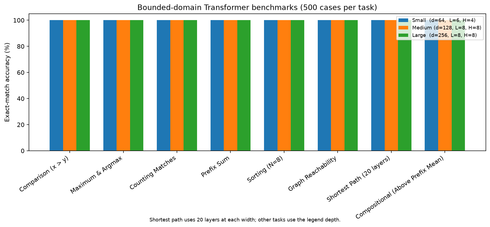

# Neural weights compiler: bounded circuit experiments

This repository explores constructing neural-network weights from hand-written circuit specifications. It contains a small MLP and Transformer intermediate representation (IR), NumPy weight backends, hand-constructed Go and MinAtar policies, and controlled circuit-grafting experiments. It was inspired by [Sparks of Weight-Space Programming](https://rikiyat.github.io/blog/weight-space-programming/) and related program-to-Transformer work such as [Tracr](https://arxiv.org/abs/2301.05062).

## Results at a glance

| Experiment | Local result | Evaluation |
| --- | --- | --- |
| **9×9 Go, 1.48M-parameter policy** | **82.0%** against the local `budget_0` checkpoint; **63.5%, 66.5%, 79.5%** against three local `ppo_s*` checkpoints (mean **69.8%**) | 200 games per opponent, 100 as each color; external checkpoints and local Go environment |
| **MinAtar, 20,486-parameter policies** | **546.81 ± 15.29** Breakout; **59.80 ± 3.49** Seaquest; **64.85 ± 2.17** Asterix | 200 episodes per game; ± is the episode standard error |
| **Transformer circuit compilation** | **500/500** on each of eight bounded tasks at each of three widths | Sorting includes duplicate integers; shortest path uses a separate 20-layer circuit and independent reference |
| **Adding an 8-digit adder to a synthetic host** | **0/500 → 500/500** addition; host task **500/500 → 500/500**, with zero measured output drift | Separately constructed sparse host with reserved registers; 100/100 carry-chain stress cases |

These are measured results, not claims that all inputs or implementations are equivalent. Go checkpoint identities and equivalence of the local game environments to the original evaluation harness have not been independently verified. The adder experiment does not use a pretrained LLM. Details and complete settings are in [the revalidation record](results/revalidation_2026-11-03.md).

### MinAtar: models alone vs. models + NeuralCompiler

| Model and method | Breakout | Seaquest | Asterix |
| --- | ---: | ---: | ---: |
| GPT-6 Astra alone¹ | 517.4 | 53.1 | 53.2 |
| GPT-6 Astra + NeuralCompiler² | 19.80 ± 1.24 | 2.74 ± 0.27 | 7.86 ± 0.54 |
| GPT-6.1 Terra alone² | 5.88 ± 0.56 | 0.18 ± 0.03 | 5.03 ± 0.31 |
| GPT-6.1 Terra + NeuralCompiler² | 47.98 ± 3.81 | 0.65 ± 0.06 | 0.43 ± 0.06 |
| Gemini 4 Argon alone³ | 71.07 ± 5.55 | — | — |
| Gemini 4 Argon + NeuralCompiler³ | 546.81 ± 15.29 | — | — |
| Gemini 4 Argon, developed manual policies³ | — | 59.80 ± 3.49 | 64.85 ± 2.17 |

¹ Published [Astra results](https://rikiyat.github.io/blog/weight-space-programming/), evaluated on 1,000 episodes; its generated policy files are not evaluated locally here. ² New, independent, zero-conversation-history subagents generated policies without training, model forward passes or rollout feedback; their outputs were subsequently scored locally on 200 episodes, seed 0. For Seaquest and Asterix, direct weight authorship was expressed as Python initialization code; the published Astra protocol required an edits block and prohibited tools. ³ Earlier work attributed to Gemini 4 Argon by the project owner: the available standalone Breakout edits and existing compiler policies were scored locally on 200 episodes. Their original generation and selection histories are not fully recorded.

The new local runs share the same environment, sticky-action probability 0.1 and 10,000-step episode cap; ± is the episode standard error. A dash means no result was produced, not a zero score. The earlier Gemini policies reflect a development process whose selection history is not recorded; its Seaquest and Asterix implementations write raw weights directly and therefore are not counted as NeuralCompiler results. The published Astra run also used a different harness and episode count. See [the experiment record](experiments/minatar_model_comparison/README.md) for prompts, policy artifacts and commands.

**Scope:** This is a research prototype, not a general natural-language-to-weights compiler. The repository does not include an automated LLM frontend. The Transformer backend operates on explicitly populated residual-stream registers, with attention, ReLU MLPs and residual connections, but no LayerNorm, token embedding or language-model output head. Its circuits require suitable register capacity, layers, heads, numerical ranges and input encodings. The experiments do not demonstrate grafting into a pretrained language model or solve the Gemma experiment from the original post.

Weight construction does not use gradient descent. Evaluation does use forward passes and, for game experiments, environment rollouts. A construction-time zero-forward-pass budget cannot be inferred from evaluation results alone: this repository does not preserve a complete development or model-selection history.

## Blind weight-reading comparison

The table places the published GPT-6 Astra results, the repository's earlier Gemini 4 Argon reports, and new GPT-6.1 Terra results side by side. The project owner identified the earlier work as Argon-produced; the historical files do not independently record the blind subagent's model identity. The published Astra results come from the [original article](https://rikiyat.github.io/blog/weight-space-programming/), not a new local run.

| Task | Published GPT-6 Astra | Earlier repository report (Argon-era) | GPT-6.1 Terra, fresh subagent |
| --- | --- | --- | --- |
| Grid policy, local file A | Article reports Breakout, 99% confidence in its illustrated example | Breakout, 98% ([report](results/exp1_subagent_response.md)) | Pong **or** Breakout-like, 45%; did not distinguish the two |
| Diffusion shape | Article reports the triangle's outline rather than its filled interior | Filled upright triangles, 95% ([report](results/exp2_subagent_response.md)) | Centered handwritten digits, 35%; acknowledged uncertainty |
| Middle Transformer blocks | Article's Python case: Python, 56% and 52% in two attempts; copy heads L2H1, L3H1, L3H5 | Python, as-is, 96%; also named L3H0 as a copy head ([report](results/exp3_subagent_response.md)) | English 36%; shuffled 55%; most heads unclear |

These are **not controlled, same-harness comparisons**. The local files' exact identity with the published examples has not been independently verified. Terra's agents were started with no conversation history, but retained normal model pretraining and system instructions. They used shell tools to read the first two files; the output was truncated and some sections were read selectively, unlike the original tool-free full-prompt protocol. The Transformer agent used weight-only NumPy operations. One agent saw both game files in the same session. The historical reports lack enough metadata to reconstruct their complete evaluation conditions, and reported confidence is not calibrated accuracy. The article lists three copy heads for its Python model; it does not support presenting the earlier report's additional L3H0 as confirmed correct.

Terra's final responses and input fingerprints are summarized in [the blind-read record](results/terra_blind_read_2026-11-03.md). Terra also guessed Snake, at 25% confidence, for local game file B; no verified label for that file is included here.

## Running the experiments

Requires Python 3 and NumPy; figure generation also requires Matplotlib. These commands were run with Python and NumPy 2.4.6. Limiting BLAS threads makes the small matrix workloads faster on some systems:

```bash
export OPENBLAS_NUM_THREADS=1
python -m unittest discover -s tests -v
python stage2_transformer_benchmark.py --output-json results/transformer_revalidation.json
python llm_compiled_unseen_tasks.py
python stage3_circuit_grafting.py
python stage1_mlp_benchmark.py
python stage1_5_go_compiler.py
python generate_figures.py
```

The MinAtar run evaluates 200 episodes per game and can take several minutes. The Go command without checkpoints only builds the policy; to evaluate opponents, pass `--checkpoints /path/to/checkpoints`. The directory must contain `budget_0`, `ppo_s0`, `ppo_s1`, and `ppo_s2` subdirectories with the weight files expected by `load_go_checkpoint`. These external checkpoints are **not included**. Missing opponents are reported and skipped. For example:

```bash
python stage1_5_go_compiler.py --checkpoints /tmp/go_checkpoints --games 200 --seed 31337
```

## Transformer circuits

The 2026-11-03 rerun evaluated eight bounded tasks with 500 deterministic-seed random examples each at three widths. Seven tasks used `(d, layers, heads)` of `(64, 6, 4)`, `(128, 8, 8)` and `(256, 8, 8)`. The shortest-path circuit uses **20 layers at each width**, respectively 0.99M, 3.96M and 15.77M parameters. Every task obtained 500/500 on its generated test set; the machine-readable data are in [results/transformer_revalidation.json](results/transformer_revalidation.json).

| Task | Small | Medium | Large | Nonzero weights |
| --- | ---: | ---: | ---: | ---: |
| Comparison | 500/500 | 500/500 | 500/500 | 7 |
| Maximum and argmax | 500/500 | 500/500 | 500/500 | 6 |
| Counting matches | 500/500 | 500/500 | 500/500 | 13 |
| Prefix sum | 500/500 | 500/500 | 500/500 | 66 |
| Sorting, including duplicates | 500/500 | 500/500 | 500/500 | 337 |
| Graph reachability | 500/500 | 500/500 | 500/500 | 80 |
| Shortest path, **20 layers** | 500/500 | 500/500 | 500/500 | 160 |
| Count above prefix mean | 500/500 | 500/500 | 500/500 | 11 |



The reported accuracy is empirical, not a guarantee outside the generated domains:

- Sorting uses length 8, integer values in `[-30, 30]` and includes repeated values. The circuit uses position to break ties; it is not claimed to support arbitrary real-valued inputs.
- Reachability uses six-node graphs with self-loops and four propagation steps.
- Shortest path uses five-node directed graphs, positive integer edge weights, zero diagonal and a finite `100` sentinel for absent edges. It performs four full sweeps of five pivots and is evaluated against an independent synchronous Bellman–Ford reference. Longer paths or different numerical scales require reassessing the sentinel and attention approximations.
- The remaining tasks similarly use fixed lengths and bounded values; their input distributions and exact-match checks are in [stage2_transformer_benchmark.py](stage2_transformer_benchmark.py).

The previous six-layer shortest-path experiment used the same incomplete pivot schedule for the circuit and reference, so its 100% did **not** establish shortest-path correctness. The previous sorting test excluded duplicate values. Regression tests now cover both failures.

Two additional hand-authored IR programs in [llm_compiled_unseen_tasks.py](llm_compiled_unseen_tasks.py) scored 500/500 each in their respective test distributions. Their actual architecture is `(d=128, layers=6, heads=4)`, with 1,186,560 parameters. The script runs existing programs; it does not invoke an LLM or independently verify the provenance of their authoring.

## Controlled circuit grafting

[stage3_circuit_grafting.py](stage3_circuit_grafting.py) builds a synthetic host with 1,582,080 allocated parameters, 95 nonzero weights and explicitly reserved resources. A hand-wired addition circuit adds 68 nonzero weights using reserved dimensions and units. In the rerun, host task accuracy was 500/500 both before and after grafting, and the maximum measured host-output difference was zero on those 500 inputs. Addition scored 500/500 random examples and 100/100 generated carry-chain stress examples.

These measurements demonstrate isolation in this specially constructed model and tested input set. They do not establish zero forgetting for arbitrary inputs, a dense pretrained network, or a model with LayerNorm; the host has separate predefined input and output registers for the new task. The accuracy before grafting is now calculated rather than printed as a constant.

## Game policies

The following are results from the local revalidation on 2026-11-03, using the repository's own environment implementations. They are descriptive rather than controlled claims of superiority over the original post's models: equivalence of environments, evaluation protocols, model selection and baseline checkpoints has not been independently established.

| MinAtar policy | Mean return ± standard error | Nonzero parameters |
| --- | ---: | ---: |
| Breakout | 546.81 ± 15.29 | 815 |
| Seaquest | 59.80 ± 3.49 | 852 |
| Asterix | 64.85 ± 2.17 | 637 |

Each result uses 200 episodes, one evaluation seed, 10% sticky actions and a 10,000-step episode cap. The standard error is across episodes in that run, not across independently selected policies or seeds. The old README's Breakout and Seaquest nonzero counts were incorrect.

For Go, 200 games per opponent were run with 100 games per color, seed 31337 and external files already present in `/tmp/go_checkpoints`:

| External checkpoint directory | Win rate | As Black | As White |
| --- | ---: | ---: | ---: |
| `budget_0` | 82.0% | 75.0% | 89.0% |
| `ppo_s0` | 63.5% | 56.0% | 71.0% |
| `ppo_s1` | 66.5% | 74.0% | 59.0% |
| `ppo_s2` | 79.5% | 84.0% | 75.0% |

The checkpoint names are labels from the local files; their source and identity have not been verified here. The custom Go implementation's equivalence to the original evaluation environment has not been established. See [results/revalidation_2026-11-03.md](results/revalidation_2026-11-03.md) for checkpoint fingerprints and run details.

## Other files

- `neural_compiler/`: IR and deterministic weight backends.
- `stage1_mlp_benchmark.py`, `stage1_5_go_compiler.py`, `stage2_transformer_benchmark.py`, `stage3_circuit_grafting.py`: experiment implementations.
- `blind_tasks/` and `results/exp*_subagent_response.md`: historical blind-task inputs and agent-produced reports. These are retained as reports, not independently verified ground truth; self-reported confidence is not a calibrated probability.
- `assets/fig*.png`: legacy figures from the earlier README. They contain historical or manually entered values and are not evidence for the updated results. `generate_figures.py` produces the new Transformer figure from saved benchmark data.
